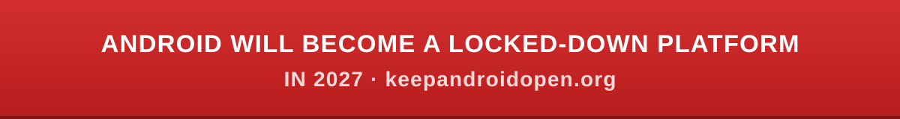

  

## -=≡Σ((( つ•̀ω•́)つ

我是`freedom-323`，很高興認識您~

**<fr323-0906@zitzhen.cn>**

### 一些不錯看的個人資訊 :
**性別** : 男

**居住地** : 香港

**最喜歡的顏色** : 是淺綠哦(

> 還有嗎？沒有了

### 我會的 :
- Python 3
- TypeScript
- Markdown
- JS
- CSS 3/4
- SCSS
- C++
- C#
- C
- HTML
- Alpine.js
- YAML
- Swift
- ADB
- Ruby
- Rust
- Kali Linux
- Solidity
- Git Bash
- Scratch 3 (當我沒說)

### 目前在做 :
###### ~一些有的沒的傻事~
